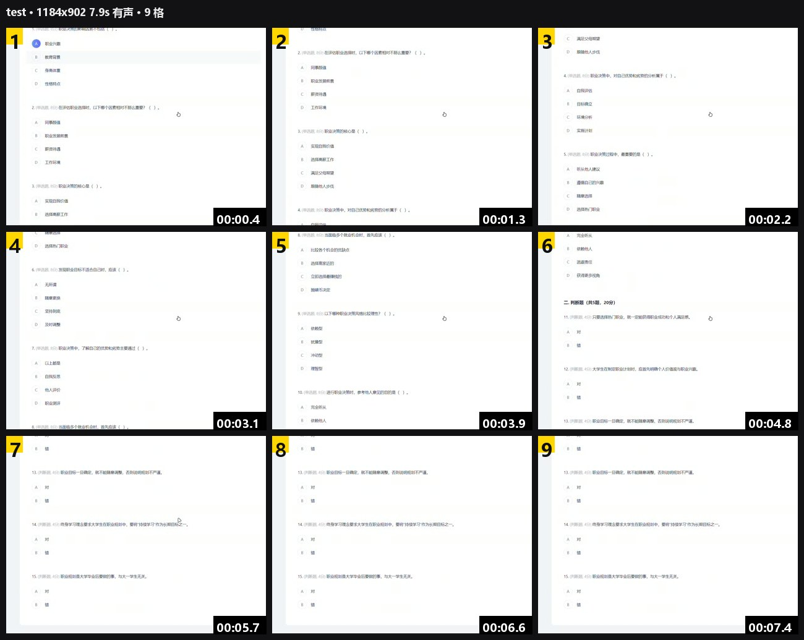

# 视频分镜 · Video Storyboard for MaiBot


> 让麦麦真的「看」得见视频：把一段视频压成**一张带格号和时间戳的分镜图**，交给宿主的视觉模型读成一段中文，再注入回原消息。B 站链接额外抓**弹幕与热评**——很多视频的笑点不在画面里，而在弹幕和评论区。

一个纯文本模型收到 QQ 视频时，看到的是 `[视频] 文件: a.mp4，大小: 3.2MB`。装了这个插件之后，她看到的是同一句话，后面多一段：

```
[视频内容] 一个男生在镜头前拆开卤味包装，先嘴硬说"清汤寡水变态辣呀"，
夹起来吃了一口立刻脸通红，一边灌水一边喊热，弹幕在刷"红温了""嘴硬的下场"。
```

<details>
<summary>English</summary>

MaiBot has no video message component, so a text-only model only ever sees `[视频] 文件: a.mp4`. This plugin turns a video into **one numbered contact sheet with timestamps**, has the host's vision model describe it, and injects the description back into the original message. For Bilibili links it also pulls **danmaku (bullet comments) and top comments**, because the joke is often in the comments rather than the frames.

Pipeline: `Hook(chat.receive.before_process)` → resolve source (adapter URL / local path / yt-dlp) → `ffprobe` + one-pass `ffmpeg` frame grab → Pillow contact sheet → `[model_task_config.vlm]` → cached description → `modified_kwargs.message`. Requires `ffmpeg`/`ffprobe`, `Pillow`, `aiohttp`, and `yt-dlp` for web links. MIT licensed.

</details>

---

## 目录

- [它解决什么问题](#它解决什么问题)
- [工作原理](#工作原理)
- [和宿主的契约](#和宿主的契约)
- [安装](#安装)
- [配置参考](#配置参考)
- [实测数据](#实测数据)
- [与其它方案对比](#与其它方案对比)
- [明确不做的](#明确不做的)
- [已知限制](#已知限制)
- [排错](#排错)
- [开发与测试](#开发与测试)
- [变更日志](#变更日志)
- [致谢与许可](#致谢与许可)

---

## 它解决什么问题

MaiBot 本身没有 Video 消息组件，适配器把视频段降级成一行文本；模型任务里也只有 `vlm`（能读图）。所以「看视频」这件事有三种笨办法：

| 笨办法 | 代价 | 结果 |
| --- | --- | --- |
| 按 1 fps 抽帧，全塞进上下文 | 60 秒片子 = 60 张图 | token 爆炸，还挤掉聊天历史 |
| 只喂标题/简介（`web_fetch`） | 便宜 | 只知道「这个视频存在」，不知道讲了什么 |
| 让模型猜 | 免费 | 一本正经地编 |

本插件的做法是第四条：**均匀抽 N 帧拼成一张图**（默认 9 格），时间信息用格号 + 时间戳表达，画面之外的语义（梗、吐槽）用弹幕和热评补。模型拿到的是一张图 + 一段文本，而不是 60 张图。

## 工作原理



上图是真实输出：9 格、每格左上角编号、右下角时间戳，顶部一行是文件名 · 分辨率 · 时长 · 有没有声音 · 格数。

```
收到消息（Hook: chat.receive.before_process）
   │
   ├─ 文本里有 [视频] / [视频文件]  → 解析出 链接 / 路径 / 文件ID
   │        └─ 本地路径直接读 → HTTP 下载（内网地址拒绝）→ 适配器缓存目录兜底
   │
   └─ 文本里有视频站链接（b23.tv、bilibili、抖音、小红书、YouTube…）
            └─ yt-dlp 提取元信息（标题/时长/落地页）→ 超长超大直接拒 → 下载 ≤480p
                    └─ B 站额外：弹幕 XML（deflate）+ 热评（/x/v2/reply/main）
   │
   ffprobe 探测时长与分辨率 → ffmpeg 按 step 抽帧（fps 与 start_time 精确对齐）
   │
   Pillow 拼图：顶部信息条（文件名 · 分辨率 · 时长 · 有没有声音 · 格数）
                每格左上角编号、右下角时间戳、格间分隔线
   │
   宿主视觉模型（[model_task_config.vlm]）读图 + 弹幕热评 → 1~3 句中文
   │
   写缓存（键：file_id → BV 号 → 路径 → 去查询串 URL）
   │
   返回 modified_kwargs.message，原文追加 "[视频内容] …"
```

三个关键设计决策：

1. **一张图，不是 N 张图。** 每张图都有一份固定开销（分辨率对齐、消息边界），拼成一张只为「一次图像计费」付一次；代价是单格清晰度下降（默认长边 420px），靠 `cells` / `cell_edge` 调。
2. **只给原材料，不下结论。** 提示词明确写「只能描述看得到的东西」「弹幕热评是观众观点，不是画面事实」「听不到声音就不要臆测」。判断交回给模型。
3. **失败要可见。** 出错时注入 `（这段视频我没看清：原因）` 而不是静默丢弃——否则模型会当作没这回事，接着编。`trigger.report_failure=false` 可关。

## 和宿主的契约

| 类型 | 名称 | 说明 |
| --- | --- | --- |
| Hook | `chat.receive.before_process` | `mode=BLOCKING`、`order=EARLY`、`timeout_ms=90000`；返回 `{"action": "continue", "modified_kwargs": {"message": …}}` |
| Tool | `video_storyboard(url)` | `visibility="deferred"`：不进首屏工具表，靠 `tool_search` 唤起（避免撑大每轮提示词） |
| Tool | `bili_search(keyword, limit=5)` | 按关键词搜 B 站，返回标题、时长、播放量、UP 主与链接；空结果自动重试一次（匿名搜索偶发 `-412`） |
| Tool | `bili_share(target)` | 把视频以「封面图 + 标题/时长/UP/链接」发到当前会话；`target` 可以是 BV 号、链接或关键词 |
| Command | `/看视频 <链接>`（别名 `/看片`、`/video`） | 手动触发，直接回一句摘要 |

三个工具都标了 `visibility="deferred"`，需要模型用 `tool_search` 自己找出来——这是有意的：它们的描述较长，常驻会挤占每轮上下文。如果你的宿主版本不支持 deferred，把 `visibility` 去掉即可。

**QQ 原生视频需要适配器带上链接。** 适配器默认会把视频段压成 `[视频] 文件: x.mp4，大小: N`，URL 和 file_id 都丢了，插件只能干瞪眼。给它两行补丁（`snowluma-adapter` 的 `codecs/inbound/message_codec.py`，`_build_video_text_segment`）：

```python
media_url = str(segment_data.get("url") or "").strip()
if media_url:
    parts.append(f"链接: {media_url}")
```

改完视频那行会变成 `[视频] 文件: x.mp4，大小: N，链接: https://…`，插件按 `文件:` / `链接:` / `路径:` / `文件ID:` 四个字段解析。**网页链接不需要这个补丁**，两种通路是独立的。

## 安装

### 依赖

| 依赖 | 必须吗 | 不装会怎样 |
| --- | --- | --- |
| `Pillow >= 10` | 必须 | 拼不了图，插件加载即报错 |
| `aiohttp >= 3.8` | 必须 | 下载与抓弹幕/热评全废 |
| `ffmpeg` + `ffprobe` | 必须 | 抽帧和探测都做不了，日志报「找不到可执行文件」 |
| `yt-dlp` | 只有网页链接需要 | 本地/QQ 原生视频照常；贴 B 站链接会回「宿主环境里没有 yt-dlp」 |
| 视觉模型 | 必须 | `[model_task_config.vlm]` 指向的模型要能读图，否则描述为空 |

插件**不打包** ffmpeg 与 yt-dlp，只调用你自己装的那份。找不到时给安装指引，不静默失败。

### 方式一：丢进插件目录

```bash
cd <实例>/modules/MaiBot/plugins
git clone https://github.com/Netsysn/maibot-video-storyboard video-storyboard
```

目录名随意，宿主按 `_manifest.json` 认插件。ffmpeg 放 `<实例>/tools/ffmpeg/bin/`（插件会从数据目录往上找到这一层），或装进 PATH，或在配置里写绝对路径。

### 方式二：插件市场

本插件登记在 [MaiBot 插件中心](https://github.com/Mai-with-u/plugin-repo) 的流程里；通过后可在 WebUI「插件市场」直接安装，搜索 **视频分镜**。

### 装完自检

1. 日志出现这行（**不用重启 OneKey**，宿主会热加载）：

   ```
   [plugin.netsysn.video-storyboard] 视频分镜 v1.4.0 已加载（ffmpeg=…\ffmpeg.exe，9 格，每张最多看 180 秒，视觉任务=vlm）
   ```

2. `ffmpeg=` 后面不是「未找到」。
3. 私聊发一句 `/看视频 https://www.bilibili.com/video/BV1xx411c7mD`，应回一句摘要。
4. 日志里能看到 `视频分镜：用 yt-dlp 下载链接 …` → `视频分镜完成（…）：…`。

## 配置参考

WebUI →「插件扩展」→「视频分镜」可视化改，或直接编辑 `config.toml`（改完热重载）。

### `[plugin]`

| 键 | 默认 | 说明 |
| --- | --- | --- |
| `config_version` | `1.4.0` | 配置结构版本，别手改 |
| `enabled` | `true` | 宿主保留键 |

### `[trigger]` 什么时候看

| 键 | 默认 | 说明 |
| --- | --- | --- |
| `trigger_mode` | `all` | `all` 每条消息都看 / `at` 只在被 @ 或私聊时看 |
| `allow_groups` / `deny_groups` | `[]` | 群白/黑名单，留空不限制 |
| `unknown_group_allow` | `true` | 适配器没给群号时是否照常处理；想只认白名单就填 `false` |
| `max_videos_per_message` | `1` | 一条消息最多看几个 |
| `max_concurrency` | `2` | 同时处理几个（多的排队，排队也有超时） |
| `skip_short_seconds` | `1.0` | 短于这个长度的不看成 |
| `link_videos` | `true` | 认消息里的视频站链接 |
| `link_domains` | 12 个 | b23.tv / bilibili / 抖音 / 小红书 / YouTube / 微博 / 腾讯视频 / 西瓜 等 |
| `report_failure` | `true` | 看失败时在消息里留一句原因 |

### `[media]` 取文件

| 键 | 默认 | 说明 |
| --- | --- | --- |
| `download_timeout_seconds` | `60` | 直链下载超时 |
| `max_file_mb` | `80` | 单文件体积上限 |
| `allow_hosts` | `[]` | 直链域名白名单；留空不限域名，但解析到内网（10/172.16/192.168/127/169.254…）一律拒绝 |
| `napcat_cache_dir` | `""` | 只有 file_id 时去这个目录翻 |
| `link_quality` | `480` | 网页视频清晰度上限，越高越慢越贵 |
| `link_max_seconds` | `600` | 超过这个时长不下载 |
| `link_timeout_seconds` | `180` | 下载总超时 |
| `max_link_mb` | `80` | 网页视频体积上限 |
| `cookies_file` | `""` | `cookies.txt` 路径；配了才拿得到 B 站字幕/会员清晰度 |

### `[storyboard]` 分镜

| 键 | 默认 | 说明 |
| --- | --- | --- |
| `ffmpeg_path` / `ffprobe_path` | `ffmpeg` / `ffprobe` | 先查 PATH，再查数据目录及其 8 级父目录、每级下的 `tools/ffmpeg/bin`；也可写绝对路径 |
| `cells` / `columns` | `9` / `3` | 格数与列数，12 / 4 也常用；再多单格就糊了 |
| `max_seconds` | `180` | 只看前 N 秒 |
| `cell_edge` | `420` | 单格长边像素（这是 token 与清晰度的旋钮） |
| `font_path` | `""` | 留空自动找（Windows 微软雅黑 / Linux Noto·文泉驿 / macOS 苹方） |
| `show_timestamp` | `true` | 每格右下角时间戳 |
| `ffmpeg_timeout_seconds` | `90` | 抽帧超时 |
| `jpeg_quality` | `85` | 输出质量 |

### `[vlm]` 视觉描述

| 键 | 默认 | 说明 |
| --- | --- | --- |
| `task_name` | `vlm` | 宿主模型任务名 |
| `model_name` | `""` | 指定模型，留空走任务默认 |
| `temperature` / `max_tokens` | `0.3` / `2048` | 思考型模型会吃掉一部分额度 |
| `max_chars` | `480` | 描述字数上限 |
| `style` | `chat` | `chat` 口语 / `detail` 详细 |
| `timeout_seconds` | `60` | 单次调用超时 |

### `[extra]` 弹幕与热评（仅 B 站）

| 键 | 默认 | 说明 |
| --- | --- | --- |
| `enabled` | `true` | 总开关 |
| `danmaku_count` / `danmaku_max_chars` | `60` / `40` | 弹幕条数（均匀抽样、去重）与单条截断 |
| `comment_count` / `comment_max_chars` | `40` / `100` | 热评条数与单条截断 |
| `comment_mode` | `3` | `3` 热度 / `2` 时间 / `1` 回复数 |
| `timeout_seconds` | `20` | 抓取超时，失败不影响看画面 |

### `[cache]` / `[debug]`

| 键 | 默认 | 说明 |
| --- | --- | --- |
| `cache.enabled` / `cache.max_entries` | `true` / `200` | 同一个视频不重复看（LRU 200 条） |
| `debug.log_ffmpeg` | `false` | ffmpeg 输出进日志 |
| `debug.keep_temp_files` | `false` | 保留抽出的帧，排查用 |

## 实测数据

单机实测（Windows 11，宿主 MaiBot 1.3.15，`vlm` = 多模态模型，480p 下载）：

| 项目 | 数字 |
| --- | --- |
| 抽帧 + 拼图（7.9 秒片 → 9 格，1300×1035，101 KB） | **0.67 s** |
| 抽帧 + 拼图（26 秒片 → 12 格，1300×1029，201 KB） | 0.39 s |
| 网页视频下载（50.8 秒竖屏，0.65 MB） | 5.9 s |
| 网页视频下载（158 秒，8.26 MB）+ 弹幕 60 条 + 热评 40 条（1,056 字） | 7~9 s |
| yt-dlp 冷启动（独立进程，含依赖导入） | 23 s |
| 单图 token（1300×1035 ≈ 1.35 MPix） | ≈ **1,800**（按 750 px/token 估）；`cell_edge=320` 可压到约 1,000 |
| 端到端（链接 → 注入文本） | **12 s** 冷启 / **< 1 s** 命中缓存 |
| 一条消息的总预算 | 75 s 硬上限，超时按失败处理 |

对照「逐帧送图」的做法：同样是 9 帧，分成 9 张独立图片时每张都有自己的固定开销，拼一张只付一次；但拼图不改变像素总量，省的是重复开销，不是免费。

## 与其它方案对比

| 方案 | 做法 | 短板 |
| --- | --- | --- |
| `web_fetch` / 网页抓取 | 只读标题、简介、置顶评论 | 不知道视频讲了什么 |
| `read-gif` 一类动图插件 | 把 GIF 交给 `vlm` 描述 | 只处理动图，视频体积与时长都吃不消 |
| 逐帧抽图 | 每秒一张，真图回传 | token 与上下文双爆 |
| [dsh-video-storyboard](https://github.com/SAOS-3624/dsh-video-storyboard) | 切镜检测 + 宫格 + 时间码清单，供 DeepSeek Harness 使用 | 是 DSH 插件（Node），不是 MaiBot 插件 |
| **本插件** | 均匀分格 + 弹幕热评 + Hook 注入 | 单帧清晰度不如逐帧方案；不做音轨 |

## 明确不做的

- **不打包 ffmpeg / yt-dlp** —— 版本与安全由使用者掌握。
- **不做音轨/ASR** —— 目前只读画面与文字材料；要「听懂」得另配 ASR 或给 `cookies_file` 拿字幕。
- **不把结论写进描述** —— 只给「看到什么」，不给「这是什么梗」（弹幕热评除外，且标注为观众观点）。
- **不烧时间码进画面中心** —— 时间戳放右下角，避免压住画面主体。
- **不递归转发节点** —— 合并转发里的视频只看第一层。

## 已知限制

- 分镜是**采样**：两个采样点之间的快速动作看不到；提示词里已声明「不要臆测」。
- 单格默认长边 420px，画面里的小字（弹幕墙、代码、PPT 正文）通常读不出，要读字得把 `cells` 调小、`cell_edge` 调大。
- 弹幕/热评只支持 B 站（接口不通用）。
- 匿名下载通常拿不到 B 站字幕；需要字幕请配 `cookies_file`。
- 极暗或大面积纯色素材，抽帧锐度判断不稳，可能选到接近的帧。
- `unknown_group_allow=true` 时，拿不到群号的场景群名单不生效（日志会 warning 一次）。

## 排错

| 现象 | 日志关键词 | 原因 | 处理 |
| --- | --- | --- | --- |
| 消息里没有 `[视频内容]` | 无任何「视频分镜」行 | 适配器没把链接写进 `[视频]` 文本 | 打上面那两行适配器补丁 |
| 加载即报错 | `找不到可执行文件: ffmpeg` | PATH 与实例目录都没有 ffmpeg | 放 `tools/ffmpeg/bin`，或 `storyboard.ffmpeg_path` 写绝对路径 |
| 网页链接失败 | `下载失败：ERROR: …` | 站点风控 / 需要登录 / yt-dlp 过期 | 配 `cookies_file`，或 `pip install -U yt-dlp` |
| 大视频被拒 | `视频太长` / `视频大约 N MB` | 触发 `link_max_seconds` / `max_link_mb` | 按需放宽，或让她先看前几分钟 |
| 注入的是「没看清」 | `视频分镜失败（…）` | 断言失败原因写在这里 | 按原因处理；不想暴露就把 `report_failure` 关掉 |
| 中文变方块 | 图里全是 □ | 缺中文字体 | `storyboard.font_path` 指定一个 ttf/ttc |
| 群里完全不触发 | 无私聊那么勤 | `trigger_mode=at` 或命中 `deny_groups` | 改 `all` 或调整名单 |
| 群名单不生效 | `拿不到群号` warning | 适配器未提供 group_id | 修适配器，或把 `unknown_group_allow` 设 `false` 保守处理 |

要复现问题，把 `debug.keep_temp_files` 打开，抽出的帧和拼图会留在数据目录的临时子目录里，重跑同一视频即可对照。

## 开发与测试

纯逻辑有单测，不需要宿主、不需要 ffmpeg、不联网：

```bash
cd video-storyboard/tests
python -m unittest test_units -v
```

> 必须在 `tests/` 目录内执行：插件目录名带连字符，`discover -s tests` 会因「目录不可导入」报错。

覆盖范围：`[视频]` 文本解析（含 `[视频文件]`、全角括号）、缓存键优先级与别名、文件名净化、链接识别、弹幕去重排序与抽样、deflate 解压上限、可执行文件解析与回退。

需要真实环境的行为（抽帧、拼图、调模型、下载）请直接在宿主里跑，然后看 `logs/maibot.log` 里「视频分镜」那几行。

```
video-storyboard/
├── plugin.py       # 宿主装配：Hook / Tool / Command、版本与依赖探测
├── pipeline.py     # 编排：取文件 → 抽帧 → 拼图 → 调模型 → 缓存（含 SSRF 与预算）
├── storyboard.py   # ffmpeg/ffprobe 调用、抽帧、拼图、字体回退
├── linkvid.py      # yt-dlp（Python API）单次提取 + 下载 + 字幕
├── bili.py         # B 站弹幕（deflate）与热评
├── vlm.py          # 视觉提示词构造与返回解析
├── config.py       # 配置模型（WebUI 表单映射）
└── tests/          # 单测
```

代码风格：`ruff`（line-length 110），无 `shell=True`，所有外部命令走参数列表。

## 变更日志

**1.5.0**
- 新增工具 `bili_search(keyword, limit)`：按关键词搜 B 站，返回标题/时长/播放量/UP 主/链接；匿名搜索偶发 `-412` 时自动隔一秒重试。
- 新增工具 `bili_share(target)`：把 BV 号、链接或关键词对应的视频以「封面图 + 标题、时长、UP 主、链接」发到当前会话（走 `send.hybrid`，失败退回纯文字）。
- 修热评抓不到：`x/v2/reply/main` 匿名请求会被风控成 `code=-352`，现在自动回退旧接口 `x/v2/reply?sort=2` 并分页合并。
- 新增 `video_info()` / `resolve_by_title()`：小程序卡片只有标题、没有链接时可用标题反查 BV 号。
- manifest 能力增加 `send.text` / `send.image` / `send.hybrid`。
- 说明：SDK 没有 `send.video`，所以转发的是「封面 + 信息 + 链接」而非 mp4 本体。

**1.4.0** —— 按一次第三方代码评审逐条修
- **P0** `ffprobe_path` 之前被忽略（永远用 ffmpeg 顶替抽帧后的探测）；现在真正解析并调用，缺失才退化并告警。
- **P0** `config.toml` 不再写死一键包用户目录；默认值可移植（PATH / `tools/ffmpeg/bin`，8 级父目录搜索）。
- **P1** 时间戳与实际帧对齐：`fps=fps=N:start_time=step/2` 一次抽帧，时间戳固定 `step*(i+0.5)`。
- **P1** 直链下载前拒绝内网地址（防 SSRF），支持 `allow_hosts` 白名单与 `Content-Length` 预检。
- **P1** 消息中的文件名不再直接拼进临时目录（路径穿越），强制视频扩展名。
- **P1** 缓存键改为 `file_id → BV → 路径 → 去查询串 URL`，短链/长链共享缓存。
- **P1** 拿不到群号时不再静默放行，新增 `trigger.unknown_group_allow`。
- **P2** 字体跨平台回退 + `getbbox()` 量文字；时长缺 `format.duration` 时兜底流级；信号量带获取超时（并发可配）；`shutil.rmtree` 清理；缓存写盘入线程；弹幕解压 8 MB 上限。
- **P2** yt-dlp 改走 Python API：一次 `extract_info` 拿标题/时长/落地页，下载前即可拒超长超大（顺带修掉 CLI `--match-filter` 的类型错误）。
- 新增 `pyproject.toml` 与 `tests/`（14 个纯逻辑单测）。

**1.3.0**
- 新增 `[extra]`：B 站弹幕（默认 60 条，均匀抽样去重）+ 热评（默认 40 条，可改排序），条数与字数可配。
- 视觉提示词区分「画面事实」与「观众观点」。
- 插件 id 改为 `netsysn.video-storyboard`，仓库公开。

**1.2.2**
- `video_storyboard` 改为 deferred 工具，修「工具存在但模型看不见」。
- 修 `ctx.paths.data_dir` 为 `str` 导致的崩溃。

**1.2.1**
- 新增工具 `video_storyboard(url)` 与命令 `/看视频`。
- Hook 改名 `video_storyboard_hook`，避免与同名工具撞车。

**1.1.0**
- 支持网页视频链接（yt-dlp），带标题与字幕；修竖屏视频的格式选择器。

**1.0.0**
- QQ 原生视频：抽帧、拼图、视觉描述、注入、缓存。

## 致谢与许可

- 分镜思路来自 [SAOS-3624/dsh-video-storyboard](https://github.com/SAOS-3624/dsh-video-storyboard)（MIT）：把视频压成一张宫格图 + 时间码清单。
- 本插件是针对 MaiBot 的重写：不依赖 Node，抽帧/拼图用 Python + Pillow，注入走宿主 Hook，并补了弹幕与热评。

MIT © [Netsysn](https://github.com/Netsysn)。见 [LICENSE](LICENSE)。
